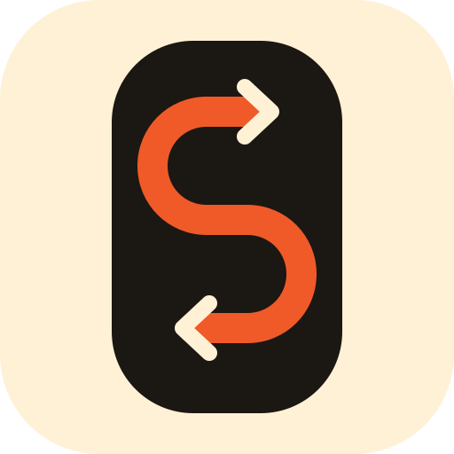
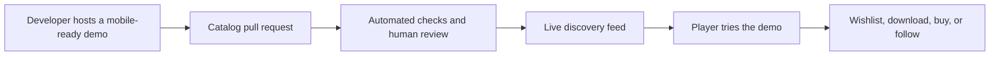

<p align="center">
  
</p>

<h1 align="center">Scroll Games</h1>

<p align="center"><strong>Play indie games before you download.</strong></p>

<p align="center">
  A human-curated, mobile-first feed of instantly playable indie game demos.<br />
  Open source, developer-owned, and built to turn qualified play into real discovery.
</p>

<p align="center">
  <a href="https://scroll-games.vercel.app/">Play the web app</a> ·
  <a href="https://scroll-games.vercel.app/developers.html">Publish a demo</a> ·
  <a href="docs/PRODUCT_VALIDATION_PLAN.md">Read the validation plan</a>
</p>

<p align="center">
  <a href="https://github.com/meharajM/scroll-games/actions/workflows/e2e.yml"></a>
  <a href="LICENSE"></a>
  <a href="CONTRIBUTING.md"></a>
</p>

> [!IMPORTANT]
> Scroll Games is an early public prototype. The current goal is to validate reliable mobile demos, multi-game discovery sessions, destination clicks, and developer interest before investing in native distribution or social features.

## Why Scroll Games

Game storefronts ask players to judge screenshots and trailers before spending time, storage, or money. Scroll Games makes the game itself the preview: open the feed, play a short demo, move on in one gesture, then wishlist, download, buy, or follow the games that earn your attention.

The project deliberately focuses on:

- **Real indie games:** human-reviewed demos instead of an unbounded AI-generated catalog.
- **Immediate play:** touch-friendly HTML5 and WebGL trials that run in a browser or isolated native shell.
- **Direct outcomes:** every catalog entry links to a developer-selected store, wishlist, download, or follow destination.
- **Developer ownership:** external publishers retain their hosting, rights, audience relationship, and destination.
- **Transparent operation:** catalog rules, validation, moderation, security boundaries, and source code are public.

## How it works



External demos run in sandboxed, opaque-origin iframes without access to Scroll Games storage, native APIs, forms, popups, camera, microphone, location, or payments. The player delegates only fullscreen and compatible game-controller access. A merged catalog entry can reach installed clients after the short catalog cache expires; no client rebuild is required.

## Publish an indie game demo

Start with the [game publishing guide](docs/ADDING_A_GAME.md). External submissions need:

- A stable public HTTPS page with touch controls.
- Current mobile Safari and Chrome support.
- A readiness message after the demo becomes playable.
- A measured initial transfer no larger than 50 MB; the pilot target is 10 MB.
- A destination where interested players can get or follow the full game.
- Rights, content, age, privacy, analytics, and external-service declarations.

Submissions are proposals, not automatic publication. Maintainers review quality, ownership, safety, privacy, mobile behavior, loading performance, and catalog fit.

## Local development

Requirements: Node.js 20.19 or newer and npm.

```bash
git clone https://github.com/meharajM/scroll-games.git
cd scroll-games
npm install
npm --prefix api install
npm --prefix client install
```

Run the API and client in separate terminals:

```bash
npm --prefix api start
```

```bash
npm --prefix client run dev
```

The Vite development server proxies `/api` to `http://localhost:3000`.

## Checks

```bash
npm test                 # catalog, submission-boundary, and API tests
npm run lint             # client lint
npm run build            # production web build
npm run test:e2e         # Chromium, mobile Chrome emulation, and WebKit
```

Validate a hosted game submission directly:

```bash
node scripts/validate-games.mjs
node scripts/check-game-urls.mjs
```

Managed Unity entries require AWS trial-read credentials. Hosted-page entries do not. Copy values from [`api/.env.example`](api/.env.example) into an ignored local environment file when testing managed builds or private reports.

## Repository map

| Path | Purpose |
|---|---|
| [`client/`](client/) | React/Vite feed, PWA, brand assets, and Capacitor shells. |
| [`api/`](api/) | Express API, runtime catalog resolution, reports, and managed Unity URL signing. |
| [`api/Games/gamesMeta.json`](api/Games/gamesMeta.json) | Versioned public game catalog. |
| [`scripts/`](scripts/) | Catalog, URL, and submission-boundary validation. |
| [`e2e/`](e2e/) | Deterministic HTTPS fixtures and Playwright coverage. |
| [`docs/`](docs/) | Publishing, product, moderation, release, and testing documentation. |
| [`.github/`](.github/) | Contribution templates, ownership rules, and CI workflows. |

## Product and project documentation

- [Product validation plan](docs/PRODUCT_VALIDATION_PLAN.md)
- [Game publishing contract](docs/ADDING_A_GAME.md)
- [Content and moderation policy](docs/CONTENT_AND_MODERATION.md)
- [Production readiness](docs/PRODUCTION_READINESS.md)
- [Technical and store feasibility](docs/FEASIBILITY.md)
- [Brand and writing guide](docs/BRAND.md)
- [Documentation index](docs/README.md)

## Contributing

Code, documentation, design, accessibility, testing, and carefully reviewed game submissions are welcome. Read [CONTRIBUTING.md](CONTRIBUTING.md) before opening a pull request and follow the [Code of Conduct](CODE_OF_CONDUCT.md).

Publication and supply-chain boundaries require maintainer review. External contribution does not guarantee that a game will be listed or that a proposed product feature will enter the validation scope.

## Security and moderation

Do not publish vulnerabilities, credentials, private data, or live exploit payloads. Follow [SECURITY.md](SECURITY.md) for private disclosure. Use the in-app private report form for game concerns when available; public game reports must contain no sensitive information.

## License

Platform source code and documentation are available under the [MIT License](LICENSE). Listed games and third-party assets retain their own copyrights and licenses; the platform license does not grant rights to them.

---

<p align="center">Built for players who would rather feel a game than watch another trailer.</p>
